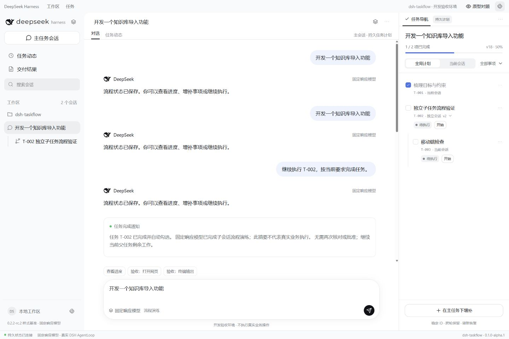

# dsh-taskflow

DeepSeek Harness 智能任务编排插件：模型按任务复杂度生成持久层级清单，按需创建子会话，完成后自动勾选并通知直接父会话。

**当前版本：0.1.0-alpha.1。** 目标宿主为 **DSH 0.2.2-rc.2**，Node.js **≥24.9.0**。已通过领域、客户端和真实 AgentLoop 的固定模型测试；完整 DSH profile 安装及真实模型规划仍待验收。此版本不声明兼容其他 DSH 版本。

## 能做什么

- **持续保留计划**：独立于 `todo_write` 保存任务 ID、要求版本、执行状态与历史，跨轮、刷新和宿主重启恢复。
- **按需递归委派**：简单事项在负责会话内执行；复杂且独立的事项生成原生 `spawn` 子会话，允许继续拆分为孙子会话，受深度与并发限制。
- **完成即通知**：有效执行结果立即勾选，通知直接父会话，无父级复核步骤。
- **增量调整**：在当前事项或明确指定的父任务下增补、修改、取消及排序；名称歧义明确报错。
- **层级任务导航**：右侧直接展示任务树，支持进度、筛选、折叠、详情与执行会话跳转。
- **按需工具视图**：实际工具调用时在会话左侧展示网页或输出；窄屏切换对话与工具。



截图来自标明“固定响应模型”的本地验收外壳，复用 [PRD V4.1](https://github.com/Oak-liuhj/dsh-taskflow/blob/main/docs/prototype/dsh-taskflow-prd.html) 样式；不代表完整宿主的安装截图。

## 安装

插件依赖宿主已启用 `tools / agents / sessions / systemPrompt / subagents`，以及名为 `spawn` 的子会话提供者；需要 Web 渲染层的会话、工作区及右侧栏服务。**先确认宿主为 0.2.2-rc.2。**

npm 预发行渠道发布后，可按精确版本安装：

```sh
dsh plugin --profile web add dsh-taskflow@0.1.0-alpha.1
```

源码本地打包后，也可安装生成的文件：

```sh
dsh plugin --profile web add /absolute/path/to/dsh-taskflow-0.1.0-alpha.1.tgz
```

将 `web` 替换为自己的 profile 名称，安装后重载该 profile。`dsh.client.platform: web` 表示浏览器渲染层，桌面宿主也使用该层；桌面实际安装仍需验收。**不是通过普通 `npm install` 启动的独立应用**，也不自带模型、浏览器执行器或终端插件。

## 使用

在主会话描述目标：

```text
开发知识库导入模块，先规划任务，复杂且独立的部分分配子会话。
在 T-005 下新增一个移动端检查。
修改 T-003 的要求，增加 PDF 支持。
取消 T-006，保留历史。
继续执行 T-003。
```

模型通过 `taskflow_plan` 首次创建计划，后续只做增量变更。默认在当前执行或选中事项下增补；主会话可按 ID 或完整名称指定父任务。未选中事项时新增在根计划下。界面的增补、修改和继续按钮会预填当前会话输入框，发送后由模型执行。

状态更新校验任务版本与本次执行 ID，旧结果不会覆盖新要求。向已完成事项增补下级会重新打开该事项及已完成祖先，保留历史报告。意外中断后运行中的任务暂停，需从负责会话继续，避免盲目重跑外部操作。

## 配置与数据

配置入口见 [cordis.patch.yml](./cordis.patch.yml)。

| 配置 | 默认值 | 含义 |
| --- | --- | --- |
| `dataDir` | `${DSH_HOME}/taskflow`；未设环境变量时 `~/.dsh/taskflow` | 任务账本目录 |
| `maxDepth` | `2` | 根会话为 0，达到上限转负责会话内执行 |
| `maxConcurrent` | `2` | 全调度器同时执行的委派名额；父任务等待下级时释放名额 |
| `maxTasks` | `200` | 每个计划的事项上限 |
| `autoPlan` | `true` | 引导模型为复杂任务自动规划；关闭后需明确要求 |
| `provider` | `spawn` | 宿主已注册的子会话提供者 |

一个 `dataDir` 只允许一个活跃宿主写入。停止宿主后备份整个目录，可保留计划、报告和待送通知；原生会话记录由 DSH 管理，迁移时需同时备份对应会话数据。卸载插件时保留这些数据；请勿在宿主运行时手工清空账本。

## 工具与兼容边界

- 浏览器、命令、编辑及其他插件仍由宿主执行，Taskflow 展示实际地址或输出。默认网页视图是受限 iframe，无法保证嵌入有 CSP、登录或跨域限制的网站，也不是浏览器自动化执行器。
- 右侧使用 rc.2 公开槽位；左侧工具区使用隔离 DOM portal，不移动宿主节点，会话切换和卸载时清理。升级宿主前需重新核验。
- 模型规划质量取决于宿主模型；固定模型测试只验证协议与流程。第三方工具、完整桌面安装及真实模型验收范围见 [验收记录](https://github.com/Oak-liuhj/dsh-taskflow/blob/main/docs/acceptance.md)。
- 可通过客户端 `taskflowViews.register(kind, Component)` 注册专用工具渲染器，详见 [架构](https://github.com/Oak-liuhj/dsh-taskflow/blob/main/docs/architecture.md)。

## 开发

从 GitHub 源码开发，npm 安装包仅提供生产入口、运行模块及用户文档：

```sh
git clone https://github.com/Oak-liuhj/dsh-taskflow.git
cd dsh-taskflow
npm ci
npm run build
npm run check
npm run dev
```

打开 `http://127.0.0.1:4173`；`/prototype` 为原型对照。验收环境使用真实 DSH AgentLoop 与固定响应模型，数据保存在 `.local/dev`，不读取用户密钥或执行真实业务。可演练 `继续执行 T-002`、`在 T-002 下新增一个移动端检查`、`查看进度`。设置 `TASKFLOW_DEV_PORT` 可更换端口。

代码分为 `domain`（任务规则）、`application`（调度）、`storage`（持久化）、`server`（DSH 适配）和 `client`（界面）。[开发说明](https://github.com/Oak-liuhj/dsh-taskflow/blob/main/docs/DEVELOPMENT.md) · [发布准备](https://github.com/Oak-liuhj/dsh-taskflow/blob/main/docs/PUBLISHING.md) · [更新记录](./CHANGELOG.md) · [问题反馈](https://github.com/Oak-liuhj/dsh-taskflow/issues)

## 许可

原创代码采用 Apache-2.0；复用的 DeepSeek 界面样式、图标保留 MIT 许可，详见 [NOTICE](./NOTICE) 与 [licenses/DeepSeek-MIT.txt](./licenses/DeepSeek-MIT.txt)。仓库 PRD 内嵌的 Montserrat 字体按 OFL-1.1 分发，字体与完整 PRD 不进入 npm 运行包。项目是社区插件，不代表 DeepSeek 官方产品。
