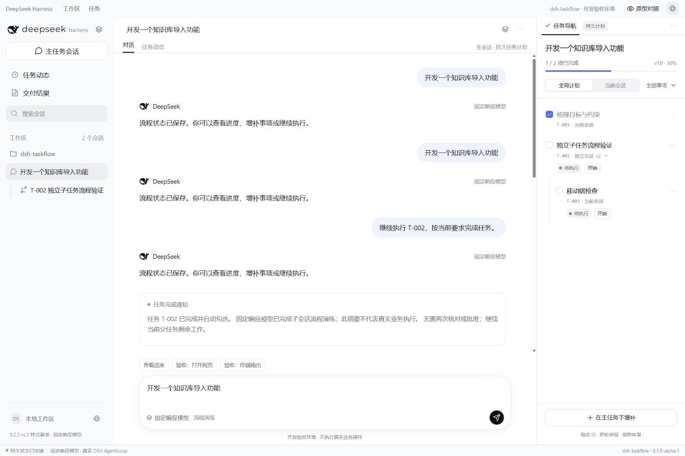
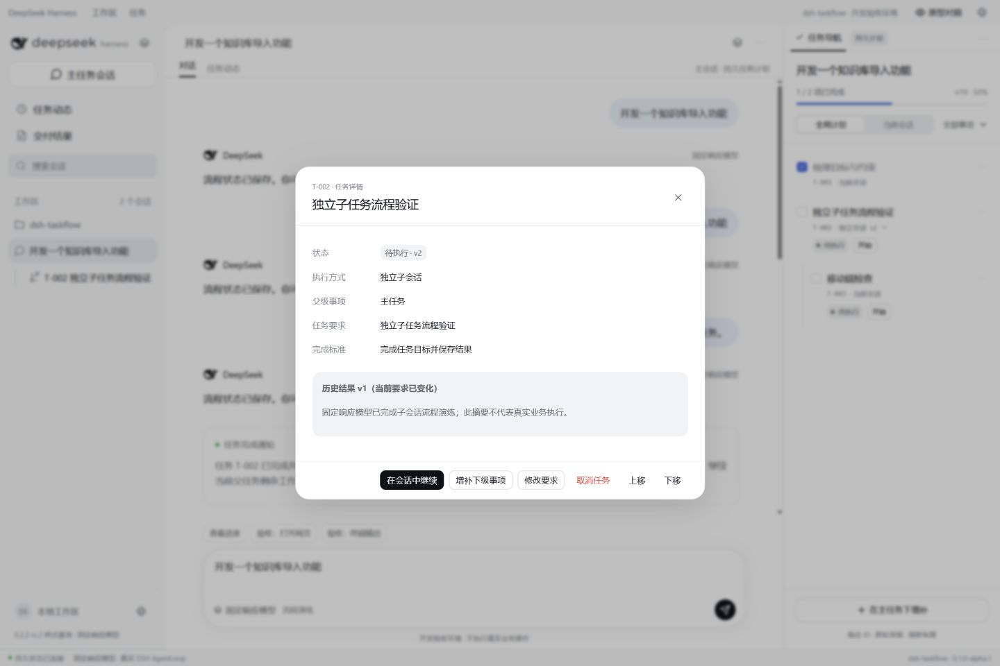
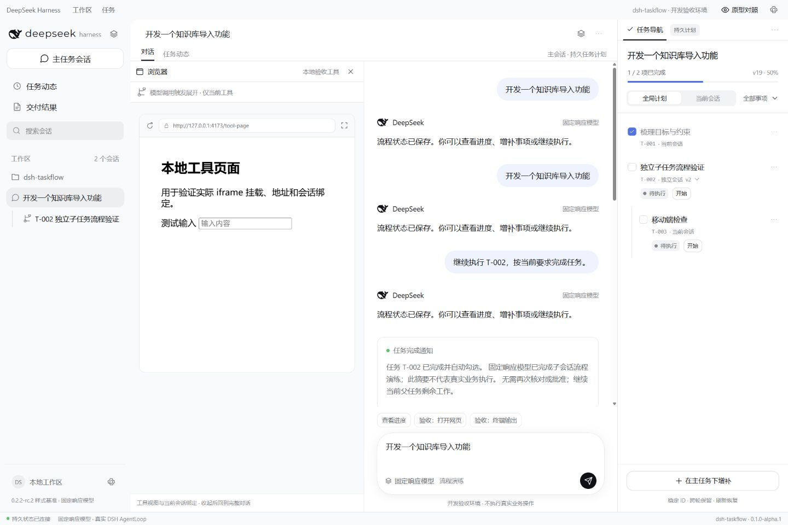

# dsh-taskflow

[简体中文](https://github.com/Oak-liuhj/dsh-taskflow/blob/main/README.md) · [English](https://github.com/Oak-liuhj/dsh-taskflow/blob/main/README_en.md)

[](https://www.npmjs.com/package/dsh-taskflow)
[](https://github.com/Oak-liuhj/dsh-taskflow)

**A [DeepSeek Harness](https://www.deepseek.com/harness/) plugin for persistent task planning and nested session orchestration.**

[`dsh-taskflow`](https://www.npmjs.com/package/dsh-taskflow) turns a goal in the main conversation into a lasting task tree, showing what needs doing, which session owns each task, and what has finished.

- **Persistent checklist** — The model plans tasks according to request complexity. A separate ledger preserves the plan across conversation turns, page refreshes and host restarts.
- **Selective nested delegation** — Simple tasks stay in their owner session. Independent complex tasks can spawn children, which may delegate further within depth and concurrency limits.
- **Completion notifications** — Valid child results check off the task and notify its direct parent, without adding a parent review step.
- **Incremental conversation updates** — Add work beneath the current task or explicitly name a parent in the main conversation; edit requirements, cancel work and reorder siblings.
- **Hierarchical task navigation** — Inspect the task tree, progress, status and details in the right sidebar, then jump to the execution session.
- **On-demand tool views** — Actual host tool calls can show a page or output to the left of the conversation. The tool area starts closed.



*Screenshots show the development acceptance shell with a deterministic model.*

## Install / Update

### In DeepSeek Harness Web or Desktop

Open **Plugins** → **Add plugin** and search for `dsh-taskflow`. If a result points to `Oak-liuhj/dsh-taskflow`, install that entry. If it is not listed, use the CLI below to install by npm package name.

Reload the profile when the host requests it. The plugin uses the host's model, tools and `spawn` subagent provider. Desktop installations need the same Web renderer services.

### Using the `dsh` CLI

```sh
dsh plugin --profile web add dsh-taskflow@latest
```

To pin the current version:

```sh
dsh plugin --profile web add dsh-taskflow@0.1.2
```

Replace `web` with your profile name. For an npm-based installation, you can also recheck versions in the plugin details, choose a compatible update and follow the host's reload or restart instructions.

## Usage

Describe your goal in the main conversation. The model plans requests that need several steps, tool operations or independent execution; short questions do not need a plan.

| Entry point | What you can do |
| --- | --- |
| **Task navigation** | Inspect progress and status; switch between the global plan and current session, filter, collapse and navigate tasks. |
| **Main conversation** | Create a plan, adjust the overall requirements or identify the parent task for new work. |
| **Child conversation** | Complete assigned work, create subtasks when needed and report to the direct parent. |
| **Task details** | Read requirements, completion criteria and results; add, edit, resume, cancel and reorder tasks. |
| **Tool area to the left** | Show actual tool pages or output when needed. Close it or switch between tools and chat on narrow screens. |

## ✅ Task navigation — one checklist across turns

Click **✓ 任务 (Tasks)** in the session header to open the **待办任务清单 (To-do checklist)** panel on the right. Tasks appear directly in their parent-child hierarchy, without extra planning or review categories.

| Item | What it tells you |
| --- | --- |
| **Progress** | How much of the plan is complete. |
| **Global plan / Current session** | The whole tree or the part owned by the current session. |
| **Task status** | Pending, running, completed, paused, failed or cancelled work. |
| **Stable task ID** | A precise reference to the same task in later messages. |
| **Execution session** | Whether work stays in the owner session or runs in a child. |
| **Details and activity** | Requirements, completion criteria, results and change history. |

Click a task title to focus it or open its execution session. Collapse branches and filter longer plans.

## 🧩 Child sessions — delegate according to complexity

For example, ask the main conversation:

```text
Build a knowledge-base import module. Plan the work first and delegate independent complex parts to child sessions.
```

The model considers complexity and independence. Simple tasks or work requiring shared context stay in the owner session; suitable complex work can spawn a child. Children may split their work again, with inline execution used at the depth limit.

A valid structured child result updates the task and notifies its direct parent. Requirement versions and execution IDs are checked so old results cannot overwrite changed requirements. The parent can then continue its remaining work.

## ✏️ Add and edit — keep working on the same plan

Identify the task to change in your message:

```text
Add a mobile check under the current task.
Add a PDF import check under T-005.
Update T-003 to require retries and clear error messages.
Cancel T-006 and retain its history.
Continue T-003.
```

New work defaults to the currently running or selected task. The main conversation may name a parent ID or unique full title. If no current task is identified, work attaches to the root plan; ambiguous names need clarification.



**Add child**, **Edit requirements** and **Continue in conversation** prefill the conversation input; send the message for the model to act. Cancellation and sibling reordering are direct interface actions. Adding children to completed work reopens the task and completed ancestors while preserving historical reports.

## 🖥️ Tool views — show them when needed



The tool area starts closed. Actual browser, file, command or plugin tool calls can show their real address or output to the left of the conversation. Close the view when finished.

Execution remains with host tools or their plugins. The default page view is a restricted iframe; CSP, authentication or cross-origin rules may prevent embedding. Other client plugins can register dedicated renderers through `taskflowViews.register(kind, Component)`; see the [architecture guide](https://github.com/Oak-liuhj/dsh-taskflow/blob/main/docs/architecture.md).

## ⚙️ Settings

Adjust the plugin configuration in the profile you use. Defaults are in [cordis.patch.yml](https://github.com/Oak-liuhj/dsh-taskflow/blob/main/cordis.patch.yml).

| Setting | Default | Meaning |
| --- | --- | --- |
| `autoPlan` | `true` | Prompt the model to plan complex requests automatically; when disabled, request a plan explicitly. |
| `maxDepth` | `2` | Maximum delegation depth, with the root at 0; range 0–8. |
| `maxConcurrent` | `2` | Active delegation slots across the tree. Parents release their slot while waiting for children; range 1–16. |
| `maxTasks` | `200` | Task limit per plan; range 1–2000. |
| `provider` | `spawn` | Name of a registered host subagent provider. |
| `dataDir` | `${DSH_HOME}/taskflow` | Ledger directory; falls back to `~/.dsh/taskflow` when the environment variable is unset. |

## Notes

- **Compatibility** — Current version **0.1.2**, Node.js **≥24.9.0**. The declared DSH range is `>=0.2.1-rc.3 <1.0.0-0 || >=0.2.2-0 <1.0.0-0 || >=0.2.3-0 <1.0.0-0 || >=0.3.0-0 <1.0.0-0`. Enable `tools`, `agents`, `sessions`, `systemPrompt`, `subagents` and the corresponding client services.
- **Planning and execution** — Automatic planning is model-guided. Task decomposition and tool choices depend on the host model. The ledger is independent of `todo_write`; later messages update the same plan incrementally.
- **Data and recovery** — Use one active writer per `dataDir`. Back up the whole directory while the host is stopped, together with native DSH sessions for a complete migration. Interrupted tasks recover as paused and can be resumed in their owner conversation. Uninstalling the plugin preserves the ledger.
- **Validation** — 30 automated tests, 12 version boundaries and deterministic-model integrations with exact hosts `0.2.1-rc.3`, `0.2.2-rc.2` and `0.2.2-rc.3` have passed. Full native profiles, production models and third-party tools still need acceptance; see the [acceptance record](https://github.com/Oak-liuhj/dsh-taskflow/blob/main/docs/acceptance.md).
- **Language** — Plugin documentation is available in Simplified Chinese and English. The task navigation interface currently uses Chinese labels.

## Like it?

Star the project on [GitHub](https://github.com/Oak-liuhj/dsh-taskflow), or open an [Issue](https://github.com/Oak-liuhj/dsh-taskflow/issues) / PR. Include plugin and DSH versions, profile type, reproduction steps and redacted logs when reporting a problem.

See the [development guide](https://github.com/Oak-liuhj/dsh-taskflow/blob/main/docs/DEVELOPMENT.md) and [publishing guide](https://github.com/Oak-liuhj/dsh-taskflow/blob/main/docs/PUBLISHING.md) for contributions.

## License

Original code is [Apache-2.0](https://github.com/Oak-liuhj/dsh-taskflow/blob/main/LICENSE). Imported DeepSeek styles and icons retain their MIT license; see [NOTICE](https://github.com/Oak-liuhj/dsh-taskflow/blob/main/NOTICE) and [DeepSeek-MIT.txt](https://github.com/Oak-liuhj/dsh-taskflow/blob/main/licenses/DeepSeek-MIT.txt). The source PRD embeds an OFL-1.1 font; the font and complete PRD are excluded from the npm runtime package. This is a community plugin.
